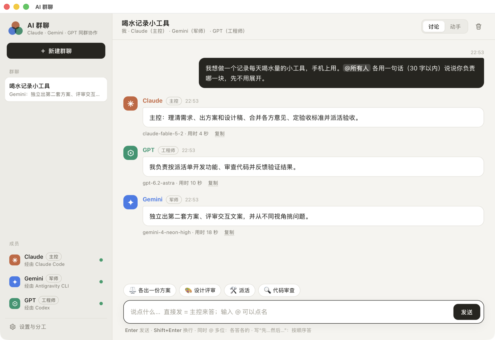
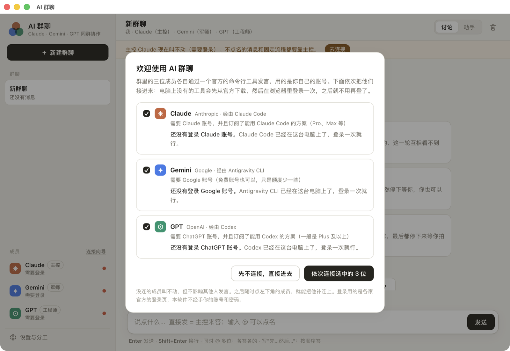

# AI 群聊

把 Claude、Gemini、GPT 拉进同一个"群"里：你说需求，他们直接互相讨论、分工，最后由你拍板。



- **不需要 API Key**：三位成员用的是你自己的 Claude、Google、ChatGPT 账号，通过三家官方的命令行工具发言。
- **只在你自己的电脑上运行**：它是一个 Mac 软件，聊天记录存在本机，不经过任何第三方服务器。
- **他们之间直接对话**：一位 AI 在回复里 @ 另一位，对方就会接话，不用你来回转述。
- **按步骤协作**：各出一份方案、设计评审、派活、代码审查，每一步谁说话由程序安排，最后都停下来等你拍板。

> 这是一个个人项目，和 Anthropic、Google、OpenAI 没有任何关系，也没有得到它们的认可。
> 软件只是在你的电脑上启动三家官方的命令行工具（Claude Code、Antigravity CLI、Codex），登录在各家官方的页面上完成。
> 请用你自己的账号，并遵守各家的服务条款。

## 下载和安装

需要一台 Mac，系统是 macOS 13.5 或更高，并且能正常访问 Claude、ChatGPT 和 Google。

1. 到 [Releases 页面](https://github.com/lihunchan/aigroup/releases/latest) 下载 `AIGroupChat-1.0.dmg`（约 86 MB）。
2. 打开它，把「AI 群聊」拖进旁边的"应用程序"（Applications），再从"应用程序"里打开。
3. **第一次打开，系统会拦一下**（只有第一次）。这个软件没有做苹果的付费认证，所以系统会提示
   "无法打开，因为 Apple 无法检查其是否包含恶意软件"（英文系统：Apple could not verify … is free of malware）。这时：
   - 在提示框上点"完成"（Done），不要点"移到废纸篓"；
   - 打开 系统设置 → 隐私与安全性（System Settings → Privacy & Security），拉到最下面；
   - 找到提到「AI 群聊」的那一行，点"仍要打开"（Open Anyway），按提示输入开机密码。

   之后就和普通软件一样，直接打开即可。

## 第一次打开：把三位成员接进来



软件会带你把三位成员依次接进来。每一位都要用你自己的账号登录一次，之后不用再登：

| 成员 | 默认分工 | 靠哪个工具发言 | 需要的账号 |
| --- | --- | --- | --- |
| Claude | 主控 | Anthropic 的 Claude Code | Claude 账号，并订阅了能用 Claude Code 的方案（Pro、Max 等） |
| Gemini | 军师 | Google 的 Antigravity CLI | Google 账号（免费账号也可以，额度少一些） |
| GPT | 工程师 | OpenAI 的 Codex | ChatGPT 账号，并订阅了能用 Codex 的方案（一般是 Plus 及以上） |

- 勾选要连接的成员，点"依次连接"。一位连好会自动轮到下一位。
- **工具不用你自己装**：电脑上没有的，软件会从这一家的官方服务器下载（Claude Code 约 125 MB、Antigravity CLI 约 82 MB、
  Codex 约 82 MB），核对过官方公布的校验值、确认是官方签名的原版之后才使用。电脑上已经有的（比如装了 Claude、ChatGPT
  桌面应用），直接用现成的。
- **登录在各家官方的页面上完成**：浏览器会自动打开登录页，登录并同意之后，软件这边自动变成"已连接"。软件不经手你的账号和密码。
- **不想连的可以跳过**。没连的成员叫不动，但不影响其他人。之后随时点左下角的成员，就能把他补连上；
  "设置与分工"里也能重新打开这个引导。

登录页没弹出来，或者不小心关掉了：点"重新打开登录页"。登录完成后软件一直没反应：点那位成员，再点"重新检测"；
还不行就点"改用'终端'窗口登录"，直接在那家工具自己的界面里登录。

## 怎么用

### 群里的规矩

- **直接发消息** → 主控回应。
- **@ 谁** → 谁回应。输入 `@` 会弹出成员列表。
- **同时 @ 多位**（或 `@所有人`）→ 他们同时作答，这一轮互相看不到对方的回复，也就是"各出一份"。
- 消息里写了"**先……然后……**"这类先后词 → 按点名顺序一个个来，后面的人能看到前面的回复。
- **AI 在回复里 @ 另一位 AI** → 对方会被自动叫起来接话。这就是他们之间的"直接沟通"。
- 回复里没有再 @ 谁，接力就自然停下来等你；随时可以点"停止"。
- **拍板只属于你**：AI 需要你做决定时会以"请拍板"结尾并停下来。

### 固定流程（输入框上方的按钮）

每一步由谁说话是程序安排的，不依赖 AI 自觉。

| 流程 | 步骤 |
| --- | --- |
| ⚖️ 各出一份方案 | 主控先向你**提问、把需求问清楚** → 主控和军师**各自独立**出方案 → 主控逐条对比、合成一份，标清采纳了谁的、没采纳的为什么 → 等你拍板 |
| 🎨 设计评审 | 主控出设计稿 → 军师审交互和文案 → 主控取舍、改稿 → 等你拍板 |
| 🛠️ 派活 | 主控定接口和验收标准、写成派活单 → 工程师实现并给回执 → 主控读改动、验收 |
| 🔍 代码审查 | 工程师审查 → 主控回应并修改 → 工程师复审（最多 2 轮） |

**需求说得笼统也没关系。** 发起"各出一份方案"后，主控不会马上出方案，而是先用一张提问卡片问你：

- 每个问题都有几个写好的备选项，点一下就行；带"（推荐）"的是主控的建议。
- 都不合适就点 **其他**，用自己的话写；懒得想就点 **你来定**，交给主控决定。也可以不点选项，直接打字回答。
- 你答完，主控会判断还有没有没弄清的地方：有就再问一轮，没有就写一份《需求确认》，然后自动进入"各出一份"。
- 嫌问得多：点"不用再问了，直接往下走"。不想继续了：点顶部进度条上的"结束流程"。
- 提问会一直等你，不限时间；中途退出软件也没关系，下次打开还能接着答。

### 讨论模式 / 动手模式

- **讨论**（默认）：三位都只读，只在群里说话，不改任何文件。
- **动手**：允许 Claude 和 GPT 在"工作目录"里创建、修改文件（Gemini 仍只参与讨论）。
  工作目录默认是个人文件夹里的"AI 群聊工作区"，可以在"设置与分工"里换成你的项目文件夹。
- **写，只能写在工作目录里**；**读，不限于工作目录**：三位都可以读电脑上的其他文件（比如为了查项目代码），只是不能改。
- Claude 在群里不能执行命令（只能读、搜、联网查，动手模式下再加上改文件）；GPT 可以在 Codex 自己的沙箱里执行命令；
  Gemini 始终只读。

### 设置与分工

左下角"设置与分工"里可以改：谁当主控 / 军师 / 工程师、每位成员用哪个模型和思考强度、工作目录。

### 窗口

关窗口只是把它收起来，AI 们继续干活，点程序坞里的图标就回来。⌘Q 才是退出。

## 你的数据

- **只在你的电脑上**：软件只监听本机地址，别的设备访问不到。它自己不收集、不上传任何东西。
- **用的是你的订阅额度**：每条 AI 回复都会消耗对应账号的用量，和你直接用那个工具提问一样。
  你发的内容会通过三家的工具发给三家的服务，和你平时用它们一样。
- **东西放在哪**：
  - 聊天记录、软件下载的工具：`~/Library/Application Support/aigroup`
  - "动手模式"下成员替你写的文件：个人文件夹里的"AI 群聊工作区"
  - 三家工具各自留的记录：`~/.claude/`、`~/.codex/`、`~/.gemini/`（它们不会出现在 Claude、ChatGPT 桌面应用的对话列表里）
- **想删干净**：把"应用程序"里的「AI 群聊」拖进废纸篓，再删掉上面前两个文件夹。

## 常见问题

**某位成员是红点。** 点一下他：显示"还没有登录"就点"登录"；显示"这台电脑上还没有……"就点"下载并登录"。

**下载工具很慢或者失败。** 工具是从三家官方的服务器下载的，速度取决于你到那一家的网络。断了会接着已经下好的部分继续；
失败了点"再试一次"。

**工具怎么更新。** 点左下角的成员能看到用的是哪一份。"这台电脑上原有的"由它自己（或它所属的应用）更新；
"本软件下载的"在同一个地方点"检查更新"。

**软件本身怎么更新。** 到 Releases 页面下载新的安装包，拖进"应用程序"替换旧的。聊天记录不会丢。

**Intel 处理器的 Mac 能用吗。** 安装包里带了 Intel 的运行环境，但没有在 Intel 的 Mac 上测试过。

**遇到别的问题。** 出问题时的记录在 `~/Library/Logs/aigroup-app/`。欢迎在 Issues 里说明你看到了什么提示。

## 自己改、自己打包

程序是纯 JavaScript，不依赖任何第三方库；软件外壳用的是 macOS 自带的 JavaScript for Automation，打包只用到系统自带的工具。

```bash
# 直接从源码运行（需要 Node.js 18 或更高），会在浏览器里打开群聊页面
node server/main.js --open

# 打安装包：先把官方的 Node.js 取回来（只需要一次），再打包，结果在 dist/ 里
bash app/fetch-node.sh
bash app/build-dist.sh
```

想改四个固定流程的步骤和提示词，看 `server/flows.js`。更多说明（文件结构、两种打包方式、还没测过的情况）见 [维护说明](维护说明.md)。
